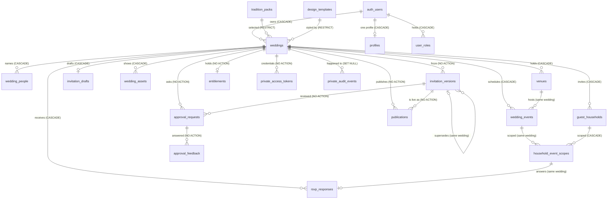

# VivaahVarnam domain model

> **This is the record of what the database now is, not what it was planned to be.** Every count,
> action and posture below was read from a Postgres catalogue after the Stage 2 forward migrations
> were applied to a fresh database, by `supabase/tests/stage2/40_catalog.sql` and the inventory
> queries quoted in
> [`../audits/stage-2-domain-database.md`](../audits/stage-2-domain-database.md) §"Catalog inventory".
> Where a *decision* rather than a *fact* is recorded, the reason is stated in the same sentence.
> The migration strategy that produced this shape, including the options rejected, is
> [`stage-2-migration-plan.md`](stage-2-migration-plan.md); the pre-implementation design it grew out
> of is [`stage-2-domain-blueprint.md`](stage-2-domain-blueprint.md), whose "Stage 2 outcome" section
> lists what was built, deferred and refused.

## 1. The four zones

Counts below are base tables, read from the catalogue at this branch's schema head (after the Stage 2
forward migrations and Stage 3's publication boundary):

| Schema | Tables | Reachable by `anon` | Reachable by `authenticated` | Reachable by `service_role` | Purpose |
| --- | --- | --- | --- | --- | --- |
| `public` | 18 | no `USAGE`-granted table: zero table privileges | SELECT on all 18; INSERT/UPDATE/DELETE on the customer-owned tables (the draft lost its INSERT/DELETE in Stage 3 §3) | full privileges | the canonical domain, plus the platform catalogue and the retained account tables |
| `api` | 0 | `USAGE`, and `EXECUTE` on exactly one function: the guest resolver | `USAGE`, and `EXECUTE` on the six host verbs | none — no `USAGE`, no `EXECUTE` | the callable surface: functions only, no table, no view, no sequence |
| `private` | 2 | no `USAGE` | no `USAGE` | `USAGE` + privileges on both | server-only history and credentials |
| `legacy` | 8 | no `USAGE` | no `USAGE` | **no `USAGE`** | archived scaffold: rows kept, no live reader |

`api` is the one zone PostgREST was given alongside `public`, which makes it the only way a browser can
ask the database to *do* something. What lives there, who may call each function and why the set is
closed is [`public-invitation-security.md`](public-invitation-security.md).

The archive being closed even to `service_role` is deliberate: an API process has no reason to read
retired commerce scaffolding, and "only a maintenance session can look" is a rule one can test
(`40_catalog.sql` C66) rather than a hope.

`legacy` carries **0 policies and 0 triggers** — reach is decided by privileges alone, so nothing in
the archive can behave differently depending on who asks.

## 2. Canonical tables and why each exists

`owner` below means "the row's fate is decided by `weddings.owner_user_id`". "Trusted write" means
only a `service_role`/maintenance path may write, and a `BEFORE` trigger refuses any client-role
attempt even if a future grant mistake let it through.

### The aggregate and what it owns

| Table | Why it exists | Key shape | Write path |
| --- | --- | --- | --- |
| `weddings` | The product's aggregate: one family's invitation, named by its owner. Replaces the scaffold's `projects`. | `id` PK; `UNIQUE (wedding_id, id)`-style children target `(id)`; `owner_user_id → auth.users` `ON DELETE CASCADE`; `design_template_id`/`tradition_pack_id` `RESTRICT` | owner (create/update/delete); `style_settings` is the only free-shaped column and is CHECKed to be a JSON object |
| `wedding_people` | Couple, hosts and family members as ordered rows, because ordered attribution is a query, not a paragraph. | `wedding_id` FK `CASCADE`; `role_key`/`role_label`, `group_key`/`group_label` are free labels | owner |
| `venues` | A place that more than one event can share, with coordinates as `numeric`. | `UNIQUE (wedding_id, id)` so an event can be pinned to *this wedding's* venue | owner |
| `wedding_events` | The functions themselves: order, enable/disable, local wall-clock times, timezone, optional venue. | `UNIQUE (wedding_id, id)`; `(wedding_id, venue_id) → venues(wedding_id, id)`; no CHECK on `event_key` (see §7) | owner |
| `invitation_drafts` | The editable content of a wedding, separated from the aggregate so content and metadata have different change rates. | `UNIQUE (wedding_id)`, and `weddings_have_draft` makes the wedding's own `INSERT` write that row in the same statement. The invariant is now total for every operation a customer can perform: `anon`/`authenticated` hold neither `INSERT` nor `DELETE` on this table (Stage 3 closed what the first trigger left open), so no browser write can create a second draft, remove one, or leave a wedding undrafted. Deleting the wedding still cascades to the draft — one aggregate. | owner SELECT + UPDATE; created and destroyed by the database |
| `wedding_assets` | Registry of uploaded/presented artwork; the object key, never the bytes. | `UNIQUE (object_key)`; `size_bytes`/`mime_type` bounded | owner; no upload path exists yet |

### Trust-bearing rows (customer-visible, customer-immutable)

| Table | Why it exists | Key shape | Write path |
| --- | --- | --- | --- |
| `invitation_versions` | An immutable statement of what was sent, so a claim on a card can be reconciled later. | `UNIQUE (wedding_id, id)`, `UNIQUE (wedding_id, version_number)`, self-FK on `(wedding_id, supersedes_version_id)`; `snapshot jsonb` object; `snapshot_schema_version` | **trusted only**; `versions_immutable_no_update/_no_delete` guards; `wedding_id` FK is `NO ACTION` so a frozen row pins its wedding |
| `publications` | The lifecycle of "this version is the live one", with at most one live link per wedding. | `UNIQUE (wedding_id, id)`; partial `UNIQUE (wedding_id) WHERE status = 'active'`; `(wedding_id, version_id)` FK `NO ACTION` | trusted only; `publications_no_client_write` |
| `entitlements` | Server-authoritative rights, the only place a paid state may exist. | `wedding_id` FK with **no cascade clause** (`NO ACTION`); partial `UNIQUE (wedding_id, package_code) WHERE status = 'active'`; `package_code` is a code, not a price | trusted only; write and delete guards |
| `approval_requests` | A recorded ask to a named family reviewer, and its answer. | `UNIQUE (wedding_id, id, version_id)` so a credential can pin request *and* wedding *and* version | trusted only; `approval_requests_no_client_write` |
| `approval_feedback` | Reviewer comments, append-only by design. | `(wedding_id, request_id, version_id)` FK `NO ACTION`; no `updated_at` to maintain | trusted insert; update and delete refused |

### Guest list and answers

| Table | Why it exists | Key shape | Write path |
| --- | --- | --- | --- |
| `guest_households` | The V1 sharing and RSVP unit — a household, not a person. | `UNIQUE (wedding_id, id)`; `expected_party_size` CHECKed non-negative | owner |
| `household_event_scopes` | Which events a household is invited to. A join table, not JSON, because "no response for an unscoped event" must be a foreign key. | PK `(wedding_id, household_id, event_id)`; both parents pinned with composite FKs | owner |
| `rsvp_responses` | One answer per household per event, and where it came from. | `UNIQUE (wedding_id, household_id, event_id)`; FK to the scope's full PK, so an out-of-scope answer is unwritable; `party_size` bounded; `response_source` distinguishes guest from host entry | owner (manual recording); the guest-facing path does not exist yet |

### Platform content

| Table | Why it exists | Key shape | Write path |
| --- | --- | --- | --- |
| `tradition_packs` | Tradition as a reviewable, versioned *behaviour pack* the host selects — never as an attribute of a person (ADR 0003). | `UNIQUE (pack_key, revision)`; `status` drives visibility; `reviewed_by → auth.users` `SET NULL` | **admin/service only** |
| `design_templates` | Reviewed artwork catalogue rows. | `UNIQUE (template_key, revision)`; `preview_svg` is server-authored and is sanitised again in the browser before insertion | **admin/service only** |

Both are readable by a signed-in user **only** while `status IN ('draft','approved')`
(`40_catalog.sql` C25 names these as the only two policies that are not owner-scoped; C09/C10 prove
the deprecated rows stay invisible). A customer cannot write either catalogue: `no_client_write_*`
triggers refuse it, and `20_attacks.sql` group 7 executes the refusal.

### Retained account tables

`profiles` (`UNIQUE (user_id)`, readable and updatable by its own user, never insertable or
deletable through the API — C23) and `user_roles` (`UNIQUE (user_id, role)`, readable by its own
user, writable by no client role; group 7 proves a user cannot self-grant `admin`).

## 3. Relational guarantees, measured

* **36 foreign keys in the canonical schemas** (`public` 30, `private` 6): 13 `CASCADE`,
  15 `NO ACTION`, 4 `RESTRICT`, 4 `SET NULL`. Every one is named in `40_catalog.sql`'s `fk_actions`
  array and C46 compares that array with `pg_constraint` in both directions, so **the schema cannot
  drift from the list without a red test**. The reasoning behind each choice is grouped by family in
  [`stage-2-migration-plan.md`](stage-2-migration-plan.md) §7; that prose is kept in step by hand and
  no test reads it. The archived `legacy` tables still carry nine foreign keys of their own; they are
  out of this count on purpose, and no API role can reach them.
* **Same-wedding pinning**: every child that can reference another child does so through a composite
  key that includes `wedding_id` (`venues`, `wedding_events`, `guest_households`,
  `household_event_scopes`, `invitation_versions`, `publications`, `approval_requests`,
  `private.access_tokens`). `20_attacks.sql` group 12 executes 12 cross-wedding insertions and all
  12 are refused with `23503`.
* **72 CHECK constraints** (62 in `public`, 10 in `private`) — the invalid states (negative guest
  counts, an active
  entitlement with a revocation timestamp, a response without an attending decision, a token kind
  with no scope, and so on) are refused at the constraint layer; group 13 executes 71 of them.
* **One active publication per wedding**, **one active entitlement per wedding+package**, both as
  partial unique indexes rather than application discipline.
* **`updated_at` is centralised**: 13 tables have the column and exactly those 13 carry a
  `set_updated_at` trigger executing the single function `private.touch_updated_at()`
  (`40_catalog.sql` C31, C37); no table keeps its own copy of that logic (C38). The
  immutable tables — `invitation_versions`,
  `approval_feedback`, `private.audit_events`, `private.access_tokens` — deliberately have **no**
  `updated_at` at all (C36), because a timestamp that can never legally change is a lie waiting to
  happen.
* **RLS is enabled and not FORCEd** on all 20 canonical tables, `private` included. "Not forced" is a
  choice: table owners and the trusted maintenance path must still be able to perform a repair, and
  the alternative is proven not to weaken a client, because a client role has no bypass (C02, group 5).
* **46 policies**, every one granted to `authenticated` alone (C18), every one `PERMISSIVE` (C19),
  exactly one SELECT per table (C20), write policies only on the customer set (C21), and **no** write
  policy at all on the trusted-authored tables (C22).

## 4. Where JSON is the right tool

Eight `jsonb` columns exist, and each is an object by constraint (`CHECK (jsonb_typeof(x) = 'object')`),
so no shape can arrive as a bare string or an array:

| Column | Contents | Why JSON rather than columns |
| --- | --- | --- |
| `weddings.style_settings` | the design editor's font/size/colour/alignment choices | the renderer's vocabulary is a Stage 3 decision; the key set is already fixed by the editor UI and is recorded in the migration's findings rather than guessed at in SQL |
| `invitation_drafts.content` | the invitation's editable text blocks | a draft is written as one unit by one author; nothing queries inside it yet |
| `tradition_packs.structure` | what a pack recommends (sections, order, wording scaffolding) | packs are authored, not parsed by the database; a table per recommendation would be a schema change per pack |
| `design_templates.layout_settings` | placement metadata for the artwork | same authoring story as above |
| `invitation_versions.snapshot` | the frozen document a publication points at | the whole purpose is a payload that is *not* reinterpreted later; `snapshot_schema_version` makes the shape evolvable |
| `rsvp_responses.answers` | free-form answers beyond attendance and party size | question sets differ per wedding; the two answers anything must query (`attending`, `party_size`) **are** columns |
| `entitlements.metadata` | opaque provenance for a trusted decision | nullable object; nothing in the client reads it |
| `private.audit_events.payload` | what a recorded action referred to, with `subject_key` kept when the subject is deleted | the event must outlive the row it describes |

The rule the stage applied, and the rule a reviewer should re-apply: **if the database has to
constrain it, join on it, or be unable to lie about it, it is a column.** Everything a later renderer
may rename lives in a `jsonb` object with an explicit schema version beside it.

## 5. Server-only structures

| Table | Contents | Deletion posture |
| --- | --- | --- |
| `private.audit_events` | append-only record of consequential actions. `wedding_id` is `SET NULL` on delete while `subject_key`/`payload` are retained, so the fact survives the object (C51). `actor_user_id` likewise `SET NULL`. | update and delete refused by trigger (C34) |
| `private.access_tokens` | **hashed** credentials only: `token_hash text NOT NULL` (a SHA-256 hex digest, C45b), `id` as PK, `token_kind`, scoped FKs to `publications` / `approval_requests` / `guest_households`, `expiry_policy`, `expires_at`, `revoked_at`, `last_used_at`, `created_by_role`. No column anywhere stores a raw token. | `wedding_id` is `NO ACTION`; delete guard present |

`20_attacks.sql` group 3 and `40_catalog.sql` C30/C61/C62/C67 show a browser role cannot `USAGE` the
schema, cannot name either table, cannot execute the guard functions directly, and cannot read a
digest. Stage 3 closed the gap Stage 2 left open here: credentials are now minted, looked up and
revoked, but only through `api` functions — `publish_invitation_version` mints (or re-parents) a
credential, `resolve_public_invitation` reads one by its digest, and no client holds a write privilege
on `private.access_tokens` at any layer. The raw string exists in one HTTP response and no column
anywhere can return it.

Trusted helpers live beside them: `private.handle_new_user` and
`private.attach_draft_on_wedding_create` — the two `SECURITY DEFINER` trigger functions, both
`search_path`-pinned, both revoked from every API role (C26/C27/C28; the draft trigger had to change
privilege when its caller lost the right to insert the row) — plus `private.reject_client_write`,
`private.reject_client_delete` and `private.touch_updated_at`, all `SECURITY INVOKER` so they cannot
be pointed at a row by someone else's privileges. The seven `api` functions are the third and only
other definer population, and their inventory is asserted, not described: see
[`public-invitation-security.md`](public-invitation-security.md) §2.

## 6. What was archived, and what happened to it

`legacy` holds the eight scaffold tables: `projects`, `templates`, `guests`, `orders`, `payments`,
`printers`, `activity_logs`, and the retired `paid_status`/`app_*` enum types were moved with them
(C03, C10 — `app_role` is the only enum left in `public`). Rows were preserved untouched; the
archived `legacy.projects.paid_status` values remain readable as history and produced **no**
`entitlements` row (migration assertion M42).

The one thing the archive deliberately changed: `legacy.payments.user_id → auth.users` was retyped
from `CASCADE` to `NO ACTION`, so deleting an account that has archived payment rows now fails
loudly instead of destroying financial history as a side effect. `legacy.projects.user_id` stays
`CASCADE`, and `legacy.orders.project_id` stays `CASCADE` — recorded in
[`stage-2-migration-plan.md`](stage-2-migration-plan.md) §7.2 as the accepted exception owned by
Stage 13's retention decision.

The Stage 0 guard trigger `projects_paid_status_guard` was dropped when its table was archived. That
is not a lost guarantee: the column it protected no longer exists in `public`, and the replacement
guarantees are "`weddings` has no billing column at all" (M65, M66) and "`entitlements` refuses
client writes" (group 7, group 8).

## 7. Domain rules the schema encodes, and the one it refuses to

Encoded:
* **Ownership is one column deep.** Every wedding-scoped table carries a NOT NULL `wedding_id`
  (C49) so an ownership check is a join-free predicate, and the isolation policies resolve
  ownership through `weddings` (C25b). This is also the performance answer: the alternative was a
  subquery through the parent on every row (directive §71's denormalisation note).
* **A guest answers only within scope.** `rsvp_responses` references the scope's full primary key, so
  an answer for an event the household was not invited to is not "rejected by a rule" — it is not
  representable.
* **Publication cannot reach across a wedding.** `publications` pins `(wedding_id, version_id)`;
  group 12 executes the cross-wedding attempt.
* **Ceremony vocabulary is the customer's.** `wedding_events.event_key`,
  `wedding_people.role_key`/`group_key` and `approval_feedback.section_key` are free `text` with no
  CHECK enumerating ritual names, because hard-coding Tamil or Telugu ceremony labels in SQL would be
  a cultural claim disguised as a constraint (directive §13). A tradition pack may *recommend*
  vocabulary in a later stage; the database will not decide it.

Refused: **no column expresses cultural identity.** `40_catalog.sql` C43/C44 scan every `public`,
`private` and `legacy` column, table and constraint name for
caste/community/religion/ethnicity/sect vocabulary
and find zero matches. The same rule runs without a database in
`scripts/domain-contract.test.mjs`, including a control set of hostile names it must catch
(`wedding_people.caste`, `weddings.inferred_religion`) and near misses it must leave alone
(`approval_feedback.section_key`, `weddings.tradition_pack_id`) — the second pair matters because a
matcher that treats `sect` as a substring of `section` reports a violation that does not exist.
`tradition_pack_id` is a *selected behaviour pack*, which is a product feature, not an attribute of a
person or a family.

Money: **no monetary column exists in `public` or `private`** (C41). `numeric` appears only as venue
coordinates (C40) and there is no `real`/`double precision` anywhere (C39). The integer-paise columns
that do exist are archived ones. No price, no GST, no package amount was invented by this stage.

## 8. Deferred, on purpose

| Concept | Status at this branch's head (schema: Stage 2 + Stage 3) | What would promote it |
| --- | --- | --- |
| Recipients / individual guests inside a household | **no table, no JSON column** | a per-recipient credential, or an RSVP that records one named person |
| Pack × template compatibility | no join table | the first real pack pairing that needs one (Stage 4) |
| Guest links | Stage 3 built the whole read path: mint, resolve, rotate, revoke, and a `/i/:token` route | what is still deferred is a guest *doing* anything — RSVP, approvals, a reply of any kind |
| Family approval UX | schema only | Stage 7 |
| Event / venue / family editors | schema only | Stage 5 |
| Uploads and Storage policies | registry table only, no Storage integration | Stage 6 |
| Entitlement granting | table + guards only, nothing ever sets `active` | Stage 10, from a real payment provider |
| Retention and erasure policy | not modelled | Stage 13 |

`data classification` below is the sensitivity view of the same territory: several of these deferred
items are deferred *because* they change who can see data.

## 9. Data classification by sensitivity

Sensitivity here means "who may see this, and how bad is a wrong answer" — not a legal category, and
**this document deliberately states no retention period.** Retention is Stage 13's decision and any
number written here would be invented.

| Data | Where it lives | Sensitivity | Who may see it today |
| --- | --- | --- | --- |
| Account identity | `auth.users` (platform), `public.profiles` | high — a name, phone, language preference | the user themselves (SELECT/UPDATE on their own row); no client can insert or delete profile rows |
| Roles and privileges | `public.user_roles` | high — a wrong answer grants platform powers | the user's own rows, read-only; no client write path, and self-granting is refused by an executed attack (group 7) |
| Wedding ownership and planning metadata | `public.weddings` | medium — title, language, an *estimate* of guests; the estimate is not a billing quantity | the owning user |
| Family and host detail | `public.wedding_people` | **high** — real names, relationships, and the free-text labels families use for each other | the owning user; never a platform reader |
| Venue and event detail | `public.venues`, `public.wedding_events` | medium — an address and approximate coordinates are location data about people who will be there | the owning user |
| Invitation content | `public.invitation_drafts.content` | medium — personal prose | the owning user |
| Guest personal data | `public.guest_households` (salutation, expected size, host notes) | **high — third-party personal data the host enters about people who are not users of this product.** `host_notes` in particular can hold anything; it is free text with no server-side meaning | the owning user; no guest-facing read path exists yet |
| RSVP answers | `public.rsvp_responses.answers` | **high** — attendance and party size reveal who will be somewhere, and free-form answers may contain dietary, mobility or health information the product never asked for and must not treat as structured data | the owning user (manual entry today); the guest submission path is Stage 8 |
| Frozen documents | `public.invitation_versions.snapshot` | high — this is the record of what was *said* to guests; immutability is what makes it usable as evidence | the owning user, read-only |
| Approval comments | `public.approval_feedback.message` | **high — a named third party (a family reviewer) writing opinions about a family's decisions.** Append-only, author recorded by label rather than by account link, and there is no reviewer login yet | the owning user; reviewer-facing view is Stage 7 |
| Public invitation surface | `public.publications` + the 11-field DTO | the moment a version becomes reachable by strangers, its sensitivity *decreases by design*: what is published is what the host chose to disclose, and the DTO is what makes that choice enumerable | `api.resolve_public_invitation` only, for one active unexpired credential; no identifier crosses |
| Entitlement / paid state | `public.entitlements` | high commercially, and **never** client-writable; a wrong answer here is a charge or a denial of service | the owning user may read their own rights; only a trusted path writes them |
| Financial history | `legacy.payments`, `legacy.orders` (archived) | high — real historical money claims that were **not** reinterpreted; archived and unreachable to every API role | a maintenance session only |
| Credentials | `private.access_tokens.token_hash` | **highest — and by construction a leak is not a credential leak**: only a digest is stored, and no browser role can read the table or even name its schema | minted by `api.publish_invitation_version`/`api.rotate_invitation_token`, hashed and compared inside `private.invitation_for_token`; no product code path reads the table |
| Audit trail | `private.audit_events` | high — it describes actions, including destructive ones, whose subjects may no longer exist | server roles only |
| Platform content | `tradition_packs`, `design_templates` | low personal sensitivity, high **reputational** sensitivity: an unreviewed pack or template becoming customer-visible is a cultural claim made by the platform | signed-in users see `draft` and `approved` rows only, and cannot write any |

Two consequences worth stating plainly: the product holds third-party data (guests, reviewers) about
people who never signed up, and Stage 8/Stage 7 must design that person's view and objection path
before those rows start accumulating in production. And `private.audit_events` keeps `subject_key`
after the subject is gone, so an erasure flow cannot be complete by deleting rows alone — that is a
Stage 13 problem, named here rather than left implicit.

## 10. Vocabulary, and the compatibility names kept

The domain word is **wedding**. `weddings`, `wedding_people`, `wedding_events`, `wedding_assets` are
the canonical names, and the only module in the app that names a table is
`src/integrations/supabase/weddings.ts`. The word "project" survives in exactly three places, all of
them deliberate and none of them a data-model statement:

| Kept name | Why kept | What it now refers to |
| --- | --- | --- |
| routes `/create-project`, `/project/:id/configure`, `/project/:id/edit` | breaking a URL a user may have bookmarked buys nothing; renaming routes is churn, not clarity | a wedding, by `weddings.id` |
| files/components `CreateProject.tsx`, `ConfigureProject.tsx`, `EditProject.tsx` | same flow, same screen; the diff that mattered is which table they touch | the `weddings` adapter |
| `WeddingSummary` / `NewWedding` / `getWeddingDesign` in the adapter | already wedding-named | canonical rows |

Inside archived SQL and historical documents the old vocabulary stays exactly where it was;
`scripts/check-product-contract.mjs` enforces both halves of that line — live code may not treat
`projects`/`templates`/`guests`/`orders`/`payments`/`printers` as the live schema, and
`docs/audits/**` remains free to record them as history.

## 11. Entity relationships

The diagram below is the schema, not a sketch of it: every FK in it appears in the C46 inventory and
every `UNIQUE (wedding_id, id)` pin the arrows depend on is in §2's key column.

Reading the compound arrows: "same wedding" means the relationship is a **composite** foreign key
through `wedding_id`, which is what makes a cross-wedding attachment unwritable rather than merely
discouraged; "NO ACTION" on a `weddings → child` arrow is the frozen-history rule from §7 of the
migration plan, and is executed in `20_attacks.sql` groups 11a–11e.

## 12. What this domain does not do yet

A guest can now be given a link and nothing else: there is no guest, RSVP or approval *screen*, no
upload path, no payment provider, no price, no admin console and no deployed schema. The editor does
now write the rows this domain owns: `ContentEditor` on the workbench adds, edits, reorders and
removes `wedding_people`, `venues` and `wedding_events` rows, which is how the Stage 3 host-to-guest
run got its content — by being typed into the product, not by seeded SQL. `npm run product:check` and the
readiness matrix
([`../product/feature-readiness.md`](../product/feature-readiness.md)) are the mechanisms that keep
this document from being read as a feature list.
