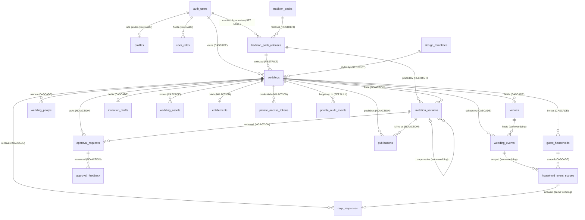

# VivaahVarnam domain model

> **This is the record of what the database now is, not what it was planned to be.** Every count,
> action and posture below was read from a Postgres catalogue after the Stage 2 forward migrations
> were applied to a fresh database, by `supabase/tests/stage2/40_catalog.sql` and the inventory
> queries quoted in
> [`../audits/stage-2-domain-database.md`](../audits/stage-2-domain-database.md) §"Catalog inventory".
> Where a *decision* rather than a *fact* is recorded, the reason is stated in the same sentence.
> The migration strategy that produced this shape, including the options rejected, is
> [`stage-2-migration-plan.md`](stage-2-migration-plan.md); the pre-implementation design it grew out
> of is [`stage-2-domain-blueprint.md`](stage-2-domain-blueprint.md), whose "Stage 2 outcome" section
> lists what was built, deferred and refused.
>
> **Stage 3 added the publication boundary and Stage 4 the tradition-pack release model, so the
> counts below are re-read at this branch's head, not copied forward from Stage 2's audit.** Where a
> number moved, the sentence that carries it says what moved it. The Stage 4 tables' own guarantee —
> that a lifecycle cannot be written backwards, that content freezes on approval, and that a
> selection must name an approved release — is executed in
> [`../audits/stage-4-tradition-pack-foundation.md`](../audits/stage-4-tradition-pack-foundation.md)
> and in `supabase/tests/stage4/`, which prints its totals separately rather than folding them into
> Stage 2's.
>
> **Stage 5 added the review binding and the maintenance surface, and it changed one column.** Its
> migration is the only schema change: `public.tradition_pack_releases.review_packet_hash text` plus
> one CHECK, no new table, no new policy, no new foreign key. Everything else Stage 5 did to the
> database was inside function bodies: eleven `internal_api` maintenance verbs, one `api` wrapper
> (`preview_invitation_document`), and five `service_role` EXECUTE grants on the digest helpers the
> release guard now calls. The catalogue numbers below are re-read for Stage 5's additions, and where
> a number is a *file-derived* count rather than a catalogue measurement this document says so — the
> reason is recorded in
> [`../audits/stage-5-pack-driven-authoring-review.md`](../audits/stage-5-pack-driven-authoring-review.md)
> §"Stage 5 truth sync closure corrections", together with the two earlier audit rows that count
> queries corrected.

## 1. The four zones

Counts below are base tables, read from the catalogue at this branch's schema head (after the Stage 2
forward migrations, Stage 3's publication boundary, Stage 4's release model and Stage 5's review
binding):

| Schema | Tables | Reachable by `anon` | Reachable by `authenticated` | Reachable by `service_role` | Purpose |
| --- | --- | --- | --- | --- | --- |
| `public` | 19 | no `USAGE`-granted table: zero table privileges | SELECT on 18 of the 19; **column**-level SELECT on `tradition_pack_releases`, seven columns only (see §2); INSERT/UPDATE/DELETE on the customer-owned tables (the draft lost its INSERT/DELETE in Stage 3 §3) | full privileges | the canonical domain, plus the platform catalogue and the retained account tables |
| `api` | 0 | `USAGE`, and `EXECUTE` on exactly one function: the guest resolver | `USAGE`, and `EXECUTE` on all eight functions: the seven host verbs and the guest resolver | none — no `USAGE`, no `EXECUTE` | the callable surface: functions only, no table, no view, no sequence |
| `private` | 2 | no `USAGE` | no `USAGE` | `USAGE` + privileges on both | server-only history and credentials |
| `legacy` | 8 | no `USAGE` | no `USAGE` | **no `USAGE`** | archived scaffold: rows kept, no live reader |

The one exception in the first row is the point of Stage 4's privilege design. `40_catalog.sql` C12
asserts that table-level SELECT is held on exactly the canonical nineteen *minus*
`tradition_pack_releases`, and C12b asserts that its column projection is exactly
`id, pack_id, release_number, status, definition_schema_version, definition, languages` — read out of
the catalogue rather than out of a list this document keeps, so a column granted later shows up as a
set difference. That leaves `author_label`, `machine_assisted`, `machine_assistance_notes`,
`source_reference`, `changelog`, every `review_*` column, `approved_at`, `deprecated_at`,
`created_at` and `updated_at` invisible to a browser role at the grant layer, before any policy or
column list is consulted. A query that cannot name a column is stronger evidence than a UI that hides
one, and it is why the readiness matrix can say the picker shows no reviewer identity without relying
on the picker.

`api` is the one zone PostgREST was given alongside `public`, which makes it the only way a browser can
ask the database to *do* something. What lives there, who may call each function and why the set is
closed is [`public-invitation-security.md`](public-invitation-security.md).

The archive being closed even to `service_role` is deliberate: an API process has no reason to read
retired commerce scaffolding, and "only a maintenance session can look" is a rule one can test
(`40_catalog.sql` C66) rather than a hope.

`legacy` carries **0 policies and 0 triggers** — reach is decided by privileges alone, so nothing in
the archive can behave differently depending on who asks.

## 2. Canonical tables and why each exists

`owner` below means "the row's fate is decided by `weddings.owner_user_id`". "Trusted write" means
only a `service_role`/maintenance path may write, and a `BEFORE` trigger refuses any client-role
attempt even if a future grant mistake let it through.

### The aggregate and what it owns

| Table | Why it exists | Key shape | Write path |
| --- | --- | --- | --- |
| `weddings` | The product's aggregate: one family's invitation, named by its owner. Replaces the scaffold's `projects`. | `id` PK; `UNIQUE (wedding_id, id)`-style children target `(id)`; `owner_user_id → auth.users` `ON DELETE CASCADE`; `design_template_id`/`tradition_pack_release_id` `RESTRICT` | owner (create/update/delete); `style_settings` is the only free-shaped column and is CHECKed to be a JSON object. `tradition_pack_release_id` is nullable, and NULL is a supported product state ("no pack — the host writes every word"), not an absent row |
| `wedding_people` | Couple, hosts and family members as ordered rows, because ordered attribution is a query, not a paragraph. | `wedding_id` FK `CASCADE`; `role_key`/`role_label`, `group_key`/`group_label` are free labels | owner |
| `venues` | A place that more than one event can share, with coordinates as `numeric`. | `UNIQUE (wedding_id, id)` so an event can be pinned to *this wedding's* venue | owner |
| `wedding_events` | The functions themselves: order, enable/disable, local wall-clock times, timezone, optional venue. | `UNIQUE (wedding_id, id)`; `(wedding_id, venue_id) → venues(wedding_id, id)`; no CHECK on `event_key` (see §7) | owner |
| `invitation_drafts` | The editable content of a wedding, separated from the aggregate so content and metadata have different change rates. | `UNIQUE (wedding_id)`, and `weddings_have_draft` makes the wedding's own `INSERT` write that row in the same statement. The invariant is now total for every operation a customer can perform: `anon`/`authenticated` hold neither `INSERT` nor `DELETE` on this table (Stage 3 closed what the first trigger left open), so no browser write can create a second draft, remove one, or leave a wedding undrafted. Deleting the wedding still cascades to the draft — one aggregate. | owner SELECT + UPDATE; created and destroyed by the database |
| `wedding_assets` | Registry of uploaded/presented artwork; the object key, never the bytes. | `UNIQUE (object_key)`; `size_bytes`/`mime_type` bounded. Since Stage 6 the key is **minted by a BEFORE trigger** as `weddings/<wedding>/<kind>/<row>` and a presented key is refused with `42501`, so this column cannot be made to name a path a browser chose. | owner, through `weddingAssets.ts` and the workbench's file panel — locally qualified in Stage 6 against the real local Storage/API stack, including 220 HTTP tests, 90 registry + 80 policy assertions, 473 unit tests and 138 browser checks (`../audits/stage-6-storage-assets.md` §37); no hosted or guest-facing upload claim |

### Trust-bearing rows (customer-visible, customer-immutable)

| Table | Why it exists | Key shape | Write path |
| --- | --- | --- | --- |
| `invitation_versions` | An immutable statement of what was sent, so a claim on a card can be reconciled later. | `UNIQUE (wedding_id, id)`, `UNIQUE (wedding_id, version_number)`, self-FK on `(wedding_id, supersedes_version_id)`; `snapshot jsonb` object; `snapshot_schema_version`; and since Stage 4 a `tradition_pack_release_id` `RESTRICT` pin, so a frozen document names the release its wording came from | **trusted only**; `versions_immutable_no_update/_no_delete` guards; `wedding_id` FK is `NO ACTION` so a frozen row pins its wedding; `versions_pack_release_gate` refuses a freeze that names anything other than the release its wedding currently selects, and refuses one that is not approved at that moment |
| `publications` | The lifecycle of "this version is the live one", with at most one live link per wedding. | `UNIQUE (wedding_id, id)`; partial `UNIQUE (wedding_id) WHERE status = 'active'`; `(wedding_id, version_id)` FK `NO ACTION` | trusted only; `publications_no_client_write` |
| `entitlements` | Server-authoritative rights, the only place a paid state may exist. | `wedding_id` FK with **no cascade clause** (`NO ACTION`); partial `UNIQUE (wedding_id, package_code) WHERE status = 'active'`; `package_code` is a code, not a price | trusted only; write and delete guards |
| `approval_requests` | A recorded ask to a named family reviewer, and its answer. | `UNIQUE (wedding_id, id, version_id)` so a credential can pin request *and* wedding *and* version | trusted only; `approval_requests_no_client_write` |
| `approval_feedback` | Reviewer comments, append-only by design. | `(wedding_id, request_id, version_id)` FK `NO ACTION`; no `updated_at` to maintain | trusted insert; update and delete refused |

### Guest list and answers

| Table | Why it exists | Key shape | Write path |
| --- | --- | --- | --- |
| `guest_households` | The V1 sharing and RSVP unit — a household, not a person. | `UNIQUE (wedding_id, id)`; `expected_party_size` CHECKed non-negative | owner |
| `household_event_scopes` | Which events a household is invited to. A join table, not JSON, because "no response for an unscoped event" must be a foreign key. | PK `(wedding_id, household_id, event_id)`; both parents pinned with composite FKs | owner |
| `rsvp_responses` | One answer per household per event, and where it came from. | `UNIQUE (wedding_id, household_id, event_id)`; FK to the scope's full PK, so an out-of-scope answer is unwritable; `party_size` bounded; `response_source` distinguishes guest from host entry | owner (manual recording); the guest-facing path does not exist yet |

### Platform content

| Table | Why it exists | Key shape | Write path |
| --- | --- | --- | --- |
| `tradition_packs` | The *concept* a host recognises — "this family's invitation is built from this pack". Stage 4 deliberately removed every content and lifecycle column from it (the old `structure`, `status`, `revision` and `reviewed_by`) because a pack that is both a concept and a document cannot be retired without breaking the concept, which is ADR 0007's whole argument. | `UNIQUE (pack_key)` — one row per concept, no revision column; `scope_statement` is required, 20–2000 characters after trimming, and is the sentence that says what the pack is for and what it does not claim | **no client write of any kind**: no policy, no table INSERT/UPDATE/DELETE privilege, and `no_client_write_tradition_packs` refuses even a deliberately granted write |
| `tradition_pack_releases` | One frozen content document of a concept: section order, labels, reviewed wording, event vocabulary, language coverage, and the provenance of who looked at it. This is the review unit, the selection target and the thing a version pins. | `UNIQUE (pack_id, release_number)`; `release_number > 0`; `status IN ('draft','reviewed','approved','deprecated')` with no other value reachable; `definition_schema_version > 0`; `languages` non-empty and inside the supported set; four *named* constraints binding status to provenance — `draft_carries_no_review_metadata`, `review_metadata_is_mandatory`, `approved_at_matches_status`, `deprecated_at_matches_status` — the last two as biconditionals, because `approved` with no `approved_at` and `draft` with a reviewer's name are the same lie in opposite directions; and since Stage 5, `review_packet_hash text` with `tradition_pack_releases_review_hash_shape` (`^[0-9a-f]{64}$`), the SHA-256 of the release's own reviewable material, computed by the guard from the row rather than accepted from a caller | **no client write**; `private.guard_tradition_pack_release()` (`SECURITY INVOKER`, self-contained by design) enforces the forward-only lifecycle, freezes the content the moment a release leaves `draft`, refuses `DELETE` of a release that has left `draft`, walks the `definition` key by key against the contract vocabulary, and since Stage 5 pins the digest (`NEW.review_packet_hash := OLD.review_packet_hash`) so no statement can set it directly |

| `design_templates` | Reviewed artwork catalogue rows. | `UNIQUE (template_key, revision)`; `preview_svg` is server-authored and is sanitised again in the browser before insertion | **admin/service only** |

`40_catalog.sql` C25 keeps "policies with no `auth.uid()` predicate" as an enumerated set rather than
a count, so Stage 4's replacement of the pack read (`users_read_packs_with_approved_releases`) and its
new release read (`users_read_approved_and_own_retired_pack_releases`) are checked by identity. The
second one is the only place in the schema where a read is deliberately wider than "approved": a host
must still be able to see the deprecated release their own wedding points at (the policy's own name
says *retired*; the status vocabulary has no such value, only `deprecated`), because §6 requires that
selection to survive for historical visibility. A customer cannot write either catalogue:
`no_client_write_*` triggers refuse it, and `20_attacks.sql` group 7 executes the refusal. **Creating
or approving a release is still not something a customer can do.** What Stage 5 added is a
*maintenance* path, not a customer one: eleven `internal_api` verbs
(`create_tradition_pack`, `create_tradition_pack_release`, `update_draft_tradition_pack_release`,
`validate_tradition_pack_release`, `get_tradition_pack_review_packet`, `submit_tradition_pack_review`,
`approve_tradition_pack_release`, `deprecate_tradition_pack_release`, `inspect_tradition_pack_release`,
`tradition_pack_catalog`, `tradition_pack_retention_report`) reached only through
`scripts/tradition-pack-admin.mjs`, which connects as the local owner identity because `service_role`
holds no `USAGE` on `internal_api` at all, has no delete verb, and refuses any flag that would point it
at a hosted project. None of those eleven names has an `api` wrapper, so no HTTP request can name one
and no browser role can execute one; the qualification fixtures the browser journeys use were created
through that CLI (`scripts/stage5-ui-journeys.mjs:163`), while the SQL batteries still drive the
lifecycle as a privileged role against a test database. Both produce `TEST ONLY` rows: synthetic
qualification data, not cultural authority. The candidate content that would go through this path is
documented in
[`../content-review/tamil-english-foundation-v1.md`](../content-review/tamil-english-foundation-v1.md).

### Retained account tables

`profiles` (`UNIQUE (user_id)`, readable and updatable by its own user, never insertable or
deletable through the API — C23) and `user_roles` (`UNIQUE (user_id, role)`, readable by its own
user, writable by no client role; group 7 proves a user cannot self-grant `admin`).

## 3. Relational guarantees, measured

* **37 foreign keys in the canonical schemas** (`public` 31, `private` 6): 13 `CASCADE`,
  15 `NO ACTION`, 5 `RESTRICT`, 4 `SET NULL`. Stage 2 measured 36 (4 `RESTRICT`); the fifth is
  `tradition_pack_releases(pack_id) → tradition_packs(id)`, and `weddings`' and
  `invitation_versions`' `RESTRICT` edges now point at releases rather than at the pack row, so
  retiring content cannot strand the documents that pinned it. Every one is named in
  `40_catalog.sql`'s `fk_actions`
  array and C46 compares that array with `pg_constraint` in both directions, so **the schema cannot
  drift from the list without a red test**. The reasoning behind each choice is grouped by family in
  [`stage-2-migration-plan.md`](stage-2-migration-plan.md) §7; that prose is kept in step by hand and
  no test reads it. The archived `legacy` tables still carry nine foreign keys of their own; they are
  out of this count on purpose, and no API role can reach them. Stage 5 added **no** foreign key, no
  table and no index; the count is unchanged at this head, read from its migration, which contains one
  `ADD CONSTRAINT` and nothing else of that kind.
* **Same-wedding pinning**: every child that can reference another child does so through a composite
  key that includes `wedding_id` (`venues`, `wedding_events`, `guest_households`,
  `household_event_scopes`, `invitation_versions`, `publications`, `approval_requests`,
  `private.access_tokens`). `20_attacks.sql` group 12 executes 12 cross-wedding insertions and all
  12 are refused with `23503`.
* **CHECK constraints: 88 measured when Stage 2 was qualified** (78 in `public`, 10 in `private`) —
  the invalid states (negative guest
  counts, an active
  entitlement with a revocation timestamp, a response without an attending decision, a token kind
  with no scope, a release that calls itself approved without an `approved_at`, a draft that carries
  a reviewer's name, and so on) are refused at the constraint layer. `20_attacks.sql` group 13
  executed **71** of the 72 that existed when Stage 2 was qualified; the 16 `public` constraints
  Stage 4 added are refused inside its own battery, where **67** expected-error patterns name a
  `23514` check violation. That battery prints its totals separately, so neither stage's
  count is read as the other's. Stage 5 added exactly one,
  `tradition_pack_releases_review_hash_shape`, and removed none, so the running total is the Stage 4
  figure plus one — a *file-derived* statement, deliberately not written as a clean catalogue number:
  Stage 4 dropped seven `tradition_packs` columns with their constraints, and the only instrument that
  counts constraints from `pg_constraint` (`40_catalog.sql`) is run by `supabase/tests/stage2/run.sh`,
  whose migration loop stops at `stage4`. The same scope note applies to every total in this document
  that a catalogue query produced; see the closure corrections in
  [`../audits/stage-5-pack-driven-authoring-review.md`](../audits/stage-5-pack-driven-authoring-review.md).
* **One active publication per wedding**, **one active entitlement per wedding+package**, both as
  partial unique indexes rather than application discipline.
* **`updated_at` is centralised**: 14 tables have the column and exactly those 14 carry a
  `set_updated_at` trigger executing the single function `private.touch_updated_at()`
  (`40_catalog.sql` C31, C37); no table keeps its own copy of that logic (C38). The one that joined
  the set in Stage 4 is `tradition_pack_releases`. The
  immutable tables — `invitation_versions`,
  `approval_feedback`, `private.audit_events`, `private.access_tokens` — deliberately have **no**
  `updated_at` at all (C36), because a timestamp that can never legally change is a lie waiting to
  happen.
* **RLS is enabled and not FORCEd** on all 21 canonical tables, `private` included. "Not forced" is a
  choice: table owners and the trusted maintenance path must still be able to perform a repair, and
  the alternative is proven not to weaken a client, because a client role has no bypass (C02, group 5).
* **45 policies**, every one granted to `authenticated` alone (C18), every one `PERMISSIVE` (C19),
  exactly one SELECT per table across the 19 (C20), write policies only on the customer set (C21), and
  **no** write policy at all on the trusted-authored tables (C22). Stage 2 closed at 46; Stage 3's
  draft-invariant repair removed two write policies on `invitation_drafts` to reach 44, and Stage 4
  dropped `users_read_platform_packs` while adding the pack and release reads to reach 45. Stage 5
  added no policy and retired none. The
  movement is arithmetic over committed migrations, and the arithmetic is in the battery, not only
  here.

## 4. Where JSON is the right tool

Eight `jsonb` columns exist, and each is an object by constraint (`CHECK (jsonb_typeof(x) = 'object')`),
so no shape can arrive as a bare string or an array:

| Column | Contents | Why JSON rather than columns |
| --- | --- | --- |
| `weddings.style_settings` | the design editor's font/size/colour/alignment choices | the renderer's vocabulary is a Stage 3 decision; the key set is already fixed by the editor UI and is recorded in the migration's findings rather than guessed at in SQL |
| `invitation_drafts.content` | the invitation's editable text blocks | a draft is written as one unit by one author; nothing queries inside it yet |
| `tradition_pack_releases.definition` | one release's whole document: section order, labels, reviewed wording, event vocabulary, design guidance | it is read as one document and frozen as one document, and the *vocabulary inside it* is what a contract governs — so the guard trigger walks it key by key rather than the schema growing a table per section. Stage 2 kept this shape on `tradition_packs.structure`; Stage 4 moved it to the release, because a concept cannot have two contents at once. `definition_schema_version` beside it is what lets a build that does not understand a definition refuse it by name instead of rendering it partially — Stage 4's guard accepted only version 1, Stage 5's accepts 1 and 2, and version 2 is where the required-section list, the provenance statements and the authoring declaration live, so an old release still resolves and a new-shaped one is refused by number rather than half-drawn |
| `design_templates.layout_settings` | placement metadata for the artwork | same authoring story as above |
| `invitation_versions.snapshot` | the frozen document a publication points at | the whole purpose is a payload that is *not* reinterpreted later; `snapshot_schema_version` makes the shape evolvable |
| `rsvp_responses.answers` | free-form answers beyond attendance and party size | question sets differ per wedding; the two answers anything must query (`attending`, `party_size`) **are** columns |
| `entitlements.metadata` | opaque provenance for a trusted decision | nullable object; nothing in the client reads it |
| `private.audit_events.payload` | what a recorded action referred to, with `subject_key` kept when the subject is deleted | the event must outlive the row it describes |

The rule the stage applied, and the rule a reviewer should re-apply: **if the database has to
constrain it, join on it, or be unable to lie about it, it is a column.** Everything a later renderer
may rename lives in a `jsonb` object with an explicit schema version beside it.

## 5. Server-only structures

| Table | Contents | Deletion posture |
| --- | --- | --- |
| `private.audit_events` | append-only record of consequential actions. `wedding_id` is `SET NULL` on delete while `subject_key`/`payload` are retained, so the fact survives the object (C51). `actor_user_id` likewise `SET NULL`. | update and delete refused by trigger (C34) |
| `private.access_tokens` | **hashed** credentials only: `token_hash text NOT NULL` (a SHA-256 hex digest, C45b), `id` as PK, `token_kind`, scoped FKs to `publications` / `approval_requests` / `guest_households`, `expiry_policy`, `expires_at`, `revoked_at`, `last_used_at`, `created_by_role`. No column anywhere stores a raw token. | `wedding_id` is `NO ACTION`; delete guard present |

`20_attacks.sql` group 3 and `40_catalog.sql` C30/C61/C62/C67 show a browser role cannot `USAGE` the
schema, cannot name either table, cannot execute the guard functions directly, and cannot read a
digest. Stage 3 closed the gap Stage 2 left open here: credentials are now minted, looked up and
revoked, but only through `api` functions — `publish_invitation_version` mints (or re-parents) a
credential, `resolve_public_invitation` reads one by its digest, and no client holds a write privilege
on `private.access_tokens` at any layer. The raw string exists in one HTTP response and no column
anywhere can return it.

Trusted helpers live beside them: `private.handle_new_user` and
`private.attach_draft_on_wedding_create` — the two `SECURITY DEFINER` trigger functions, both
`search_path`-pinned, both revoked from every API role (C26/C27/C28; the draft trigger had to change
privilege when its caller lost the right to insert the row) — plus `private.reject_client_write`,
`private.reject_client_delete` and `private.touch_updated_at`, all `SECURITY INVOKER` so they cannot
be pointed at a row by someone else's privileges. The other definers are the `internal_api` bodies
behind the `api` wrappers — eight at this head, the seven publication verbs plus Stage 5's
`preview_invitation_document` — while every one of the eight `api` wrappers is `SECURITY INVOKER`
(measured as `api_invoker = 8` beside `internal_definer = 8` by the function-inventory group I3),
which is what C26b ("nothing exposed through the Data API acts above its caller")
holds — and that inventory is asserted, not described: see
[`public-invitation-security.md`](public-invitation-security.md) §2.

Stage 4 created **seven** more `private` functions — `guard_tradition_pack_release()` (the lifecycle
and vocabulary guard), `require_approved_pack_release()` and `require_frozen_pack_release()` (the two
write gates), `default_invitation_definition()` (the definition a wedding with **no** pack resolves
against, written in the same shape as a release's so the pack path and the no-pack path are one code
path), `pack_text_for()` (one language map, three outcomes: the requested language, an English text
the *release* declared as a fallback, or nothing — with the middle case recorded rather than
silently returned), `resolve_invitation_sections()` (wording resolution at freeze time) and
`invitation_freeze_issues()` (the reasons a candidate snapshot may not be frozen, collected as a list
so a refusal can name all of them at once). — and rewrote four that already existed
(`build_invitation_snapshot`, `public_invitation_dto`, `internal_api.create_invitation_version`,
`internal_api.preview_invitation`). **None of the nine `private` functions Stage 4 created or
rewrote is a definer**: each one carries `SECURITY INVOKER` and `SET search_path = ''` in its own
definition (`20260927120000_stage4_tradition_pack_releases.sql:201, 704, 753, 813, 847, 893, 987,
1074, 1176`), and sixteen of the eighteen `private` functions **at the Stage 4 head** are invokers —
the two exceptions are the trigger definers named in the paragraph above, and that count was read from
`pg_proc.prosecdef` on the running local database, not inferred from the migration text. Stage 5
carried the same rule forward: of the **27** `private` functions at the Stage 5 head (measured by the
inventory group I4, which expects `private = 27` where it expected `18` at Stage 4's head) all but the
two trigger definers are invokers, and the five digest helpers the guard now calls —
`canonical_token`, `jsonb_canonical`, `review_field`, `tradition_pack_review_hash`,
`tradition_pack_review_payload` — are the *only* functions in `private` that `service_role` may
execute, asserted as a named set of five and not a widening (`50_review_binding.sql` M6/M6b/M8). The two
`internal_api` rewrites are definers, as they were before this stage, and remain inside the eight
verbs the `api` wrappers delegate to. That choice is load-bearing
rather than stylistic. A `SECURITY DEFINER` release guard would read a release the caller cannot see
and then decide from it, which turns a content-maintenance function into a read path with privileges
of its own; an invoker guard answers the same question with whatever the caller could already name,
so "not readable" *is* the refusal a customer gets — measured in
`supabase/tests/api/stage4_tradition_packs.test.mjs` SEL-03, where a draft, a reviewed and a
deprecated release, another pack's retired release, a uuid that is not a release at all and the zero
uuid all come back as HTTP 403 with code `42501`, a null hint and the gate's own sentence. The
catalogue's definer population is asserted by identity in C26 and each one's `search_path` is
pinned by C27, so a tenth definer — or a name swapped into that set — is meant to be a red test rather
than a review finding. **At this head it is not one, and saying so is part of the truth sync.** C26's
name list is the nine definers of the Stage 4 head — the seven publication bodies plus the two trigger
helpers — and `40_catalog.sql` is run only by `supabase/tests/stage2/run.sh`, whose migration loop
stops at `stage4`, so the Stage 5 schema is never compared against it; the tenth definer,
`internal_api.preview_invitation_document`, therefore has no identity pin at the head it exists at.
What does run at this head pins the population by count and by posture instead: I3 (`internal_definer
= 8`, `api_invoker = 8`), I4 (`api = 8`, `internal_api = 19`, `private = 27`), M7 (no pack-table
trigger is a definer) and M7b (none of the eleven maintenance bodies is a definer). The forward repair
is to make the catalogue battery head-aware exactly as I3/I4 already are and enumerate the ten names —
a change that has to be *measured*, so it waits for the local stack rather than being written from the
migration text; it is recorded in
[`../audits/stage-5-pack-driven-authoring-review.md`](../audits/stage-5-pack-driven-authoring-review.md)
§"Stage 5 truth sync closure corrections". So the count at the Stage 5 head is
**ten** `SECURITY DEFINER` functions outside `pg_catalog` — the eight `internal_api` bodies plus the
two trigger helpers above — measured, not inferred.

## 6. What was archived, and what happened to it

`legacy` holds the eight scaffold tables: `projects`, `templates`, `guests`, `orders`, `payments`,
`printers`, `activity_logs`, and the retired `paid_status`/`app_*` enum types were moved with them
(C03, C10 — `app_role` is the only enum left in `public`). Rows were preserved untouched; the
archived `legacy.projects.paid_status` values remain readable as history and produced **no**
`entitlements` row (migration assertion M42).

The one thing the archive deliberately changed: `legacy.payments.user_id → auth.users` was retyped
from `CASCADE` to `NO ACTION`, so deleting an account that has archived payment rows now fails
loudly instead of destroying financial history as a side effect. `legacy.projects.user_id` stays
`CASCADE`, and `legacy.orders.project_id` stays `CASCADE` — recorded in
[`stage-2-migration-plan.md`](stage-2-migration-plan.md) §7.2 as the accepted exception owned by
Stage 13's retention decision.

The Stage 0 guard trigger `projects_paid_status_guard` was dropped when its table was archived. That
is not a lost guarantee: the column it protected no longer exists in `public`, and the replacement
guarantees are "`weddings` has no billing column at all" (M65, M66) and "`entitlements` refuses
client writes" (group 7, group 8).

## 7. Domain rules the schema encodes, and the one it refuses to

Encoded:
* **Ownership is one column deep.** Every wedding-scoped table carries a NOT NULL `wedding_id`
  (C49) so an ownership check is a join-free predicate, and the isolation policies resolve
  ownership through `weddings` (C25b). This is also the performance answer: the alternative was a
  subquery through the parent on every row (directive §71's denormalisation note).
* **A guest answers only within scope.** `rsvp_responses` references the scope's full primary key, so
  an answer for an event the household was not invited to is not "rejected by a rule" — it is not
  representable.
* **Publication cannot reach across a wedding.** `publications` pins `(wedding_id, version_id)`;
  group 12 executes the cross-wedding attempt.
* **Ceremony vocabulary is the customer's.** `wedding_events.event_key`,
  `wedding_people.role_key`/`group_key` and `approval_feedback.section_key` are free `text` with no
  CHECK enumerating ritual names, because hard-coding Tamil or Telugu ceremony labels in SQL would be
  a cultural claim disguised as a constraint (directive §13). Stage 4 is the "later stage" that
  blueprint sentence pointed at, and it kept that rule: a release *may* carry an
  `event_vocabulary` array inside its `definition`, which the guard validates as a shape (at most 50
  entries, slug keys, label strings, no unknown keys) and never as a set of permitted ceremonies. The
  vocabulary is a recommendation a host can decline, `wedding_events` still accepts any key, and —
  measured rather than assumed — **nothing in a frozen snapshot or in the guest's document is drawn
  from `event_vocabulary` today**; it is parsed by `src/lib/traditionPackDefinition.ts` and validated,
  and no renderer reads it. Saying so matters, because "the pack supplies the ceremony names" is the
  kind of sentence that would make the mechanism sound like a claim about culture.

Refused: **no column expresses cultural identity.** `40_catalog.sql` C43/C44 scan every `public`,
`private` and `legacy` column, table and constraint name for
caste/community/religion/ethnicity/sect vocabulary
and find zero matches. The same rule runs without a database in
`scripts/domain-contract.test.mjs`, including a control set of hostile names it must catch
(`wedding_people.caste`, `weddings.inferred_religion`) and near misses it must leave alone
(`approval_feedback.section_key`, `weddings.tradition_pack_release_id`,
`invitation_versions.tradition_pack_release_id`, `tradition_pack_releases.definition`,
`tradition_packs.pack_key`) — the matcher that treats `sect` as a substring of `section` reports a
violation that does not exist, and that failure mode is why the near-miss list is a test.
`tradition_pack_release_id` is a *selected, reviewed document version*, which is a product feature,
not an attribute of a person or a family; the same file asserts in the other direction that
`weddings` no longer contains `tradition_pack_id`, so the retired shape cannot come back unnoticed.

Money: **no monetary column exists in `public` or `private`** (C41). `numeric` appears only as venue
coordinates (C40) and there is no `real`/`double precision` anywhere (C39). The integer-paise columns
that do exist are archived ones. No price, no GST, no package amount was invented by this stage.

## 8. Deferred, on purpose

| Concept | Status at this branch's head (schema: Stage 2 + Stage 3 + Stage 4 + Stage 5 + Stage 6) | What would promote it |
| --- | --- | --- |
| Recipients / individual guests inside a household | **no table, no JSON column** | a per-recipient credential, or an RSVP that records one named person |
| Pack × template compatibility | still **no join table**. Stage 4 reached the pack model, not this one: a release's `design_guidance` is validated as a shape and nothing pairs a release with a `design_templates` row | the first real pairing a customer can choose, rather than two catalogues that happen to exist |
| Content authoring for a release | **no customer-facing surface**, and that boundary held: Stage 5 added eleven `internal_api` maintenance verbs and `scripts/tradition-pack-admin.mjs`, which is a local operator tool with no delete verb that refuses any hosted target. There is still no write policy, no `api` wrapper and no admin screen for a browser role | Stage 7's review workflow, if the review is ever to be done by a named person inside the product rather than by a maintenance identity at a terminal |
| Guest links | Stage 3 built the whole read path: mint, resolve, rotate, revoke, and a `/i/:token` route; Stage 4 re-qualified it with a pack block in the DTO; Stage 5 made the same route resolve a release's document and re-qualified it again (journey B and C, `scripts/stage5-ui-journeys.mjs`) | what is still deferred is a guest *doing* anything — RSVP, approvals, a reply of any kind |
| Family approval UX | schema only | Stage 7 |
| Event / venue / family editors | **built, not schema only** — `ContentEditor` on the workbench adds, edits, reorders and removes `wedding_people`, `venues` and `wedding_events` rows through the adapters, which is how journeys A, B and C got their content. Stage 5 extended the same workbench with the pack-driven section editor and the server-side issue records | what is still deferred is a *richer* editor (drag-reorder, inline media), not the row writes |
| Uploads and Storage policies | Stage 6 wrote the integration this row deferred: the private `wedding-assets` bucket with a 5 MiB ceiling and four MIME types, the minted key, the three `storage.objects` policies, the lifecycle guards, one adapter and the host's file panel. **Built, and locally qualified at the state that carries it**: HTTP 220 tests / 0 fail, the two Stage 6 SQL batteries (90 registry + 80 storage policy) with every historical suite at a schema that contains Stage 6, 473 unit tests, and a browser tier that drove the panel through upload, preview, replace and remove with the N1–N4 privacy checks and the two-viewport accessibility re-measurement (`../audits/stage-6-storage-assets.md` §37; §18's engine outage is what §§36–37 closed). **Local stack only** — nothing here ran against a hosted project, and the 60-second preview expiry is asserted as a link shape, never as an elapsed-time measurement | what is still deferred is a guest seeing an uploaded file, and §7 of that audit explains why that needs its own threat model, a minting path for guest-delivered media and a stated retention rule rather than a policy tweak |
| Entitlement granting | table + guards only, nothing ever sets `active` | Stage 10, from a real payment provider |
| Retention and erasure policy | not modelled | Stage 13 |

`data classification` below is the sensitivity view of the same territory: several of these deferred
items are deferred *because* they change who can see data.

## 9. Data classification by sensitivity

Sensitivity here means "who may see this, and how bad is a wrong answer" — not a legal category, and
**this document deliberately states no retention period.** Retention is Stage 13's decision and any
number written here would be invented.

| Data | Where it lives | Sensitivity | Who may see it today |
| --- | --- | --- | --- |
| Account identity | `auth.users` (platform), `public.profiles` | high — a name, phone, language preference | the user themselves (SELECT/UPDATE on their own row); no client can insert or delete profile rows |
| Roles and privileges | `public.user_roles` | high — a wrong answer grants platform powers | the user's own rows, read-only; no client write path, and self-granting is refused by an executed attack (group 7) |
| Wedding ownership and planning metadata | `public.weddings` | medium — title, language, an *estimate* of guests; the estimate is not a billing quantity | the owning user |
| Family and host detail | `public.wedding_people` | **high** — real names, relationships, and the free-text labels families use for each other | the owning user; never a platform reader |
| Venue and event detail | `public.venues`, `public.wedding_events` | medium — an address and approximate coordinates are location data about people who will be there | the owning user |
| Invitation content | `public.invitation_drafts.content` | medium — personal prose | the owning user |
| Guest personal data | `public.guest_households` (salutation, expected size, host notes) | **high — third-party personal data the host enters about people who are not users of this product.** `host_notes` in particular can hold anything; it is free text with no server-side meaning | the owning user; no guest-facing read path exists yet |
| RSVP answers | `public.rsvp_responses.answers` | **high** — attendance and party size reveal who will be somewhere, and free-form answers may contain dietary, mobility or health information the product never asked for and must not treat as structured data | the owning user (manual entry today); the guest submission path is Stage 8 |
| Frozen documents | `public.invitation_versions.snapshot` | high — this is the record of what was *said* to guests; immutability is what makes it usable as evidence | the owning user, read-only |
| Approval comments | `public.approval_feedback.message` | **high — a named third party (a family reviewer) writing opinions about a family's decisions.** Append-only, author recorded by label rather than by account link, and there is no reviewer login yet | the owning user; reviewer-facing view is Stage 7 |
| Public invitation surface | `public.publications` + the 11-field DTO | the moment a version becomes reachable by strangers, its sensitivity *decreases by design*: what is published is what the host chose to disclose, and the DTO is what makes that choice enumerable | `api.resolve_public_invitation` only, for one active unexpired credential; no identifier crosses |
| Entitlement / paid state | `public.entitlements` | high commercially, and **never** client-writable; a wrong answer here is a charge or a denial of service | the owning user may read their own rights; only a trusted path writes them |
| Financial history | `legacy.payments`, `legacy.orders` (archived) | high — real historical money claims that were **not** reinterpreted; archived and unreachable to every API role | a maintenance session only |
| Credentials | `private.access_tokens.token_hash` | **highest — and by construction a leak is not a credential leak**: only a digest is stored, and no browser role can read the table or even name its schema | minted by `api.publish_invitation_version`/`api.rotate_invitation_token`, hashed and compared inside `private.invitation_for_token`; no product code path reads the table |
| Audit trail | `private.audit_events` | high — it describes actions, including destructive ones, whose subjects may no longer exist | server roles only |
| Platform content | `tradition_packs`, `tradition_pack_releases`, `design_templates` | low personal sensitivity, high **reputational** sensitivity: an unreviewed pack or template becoming customer-visible is a cultural claim made by the platform | a signed-in user reads a pack only when it has an approved release, and reads a release only when it is approved *or* it is the retired one their own wedding points at — and can name only seven of its twenty-three columns, so the reviewer's identity, stated qualification, machine-assistance notes and the review digest (`review_packet_hash`, which is what binds a review to the bytes it covered) are not merely hidden but ungrantable. No client writes any of it |

Two consequences worth stating plainly: the product holds third-party data (guests, reviewers) about
people who never signed up, and Stage 8/Stage 7 must design that person's view and objection path
before those rows start accumulating in production. And `private.audit_events` keeps `subject_key`
after the subject is gone, so an erasure flow cannot be complete by deleting rows alone — that is a
Stage 13 problem, named here rather than left implicit.

## 10. Vocabulary, and the compatibility names kept

The domain word is **wedding**. `weddings`, `wedding_people`, `wedding_events`, `wedding_assets` are
the canonical names, and the only modules in the app that name a table are the five under
`src/integrations/supabase/` — `weddings.ts`, `weddingContent.ts`, `traditionReleases.ts` (which is
where `tradition_packs` and `tradition_pack_releases` are allowed to appear), `publication.ts` and
`publicInvitation.ts`, the last two reaching only `api` functions. The word "project" survives in
exactly three places, all of
them deliberate and none of them a data-model statement:

| Kept name | Why kept | What it now refers to |
| --- | --- | --- |
| routes `/create-project`, `/project/:id/configure`, `/project/:id/edit` | breaking a URL a user may have bookmarked buys nothing; renaming routes is churn, not clarity | a wedding, by `weddings.id` |
| files/components `CreateProject.tsx`, `ConfigureProject.tsx`, `EditProject.tsx` | same flow, same screen; the diff that mattered is which table they touch | the `weddings` adapter |
| `WeddingSummary` / `NewWedding` / `getWeddingDesign` in the adapter | already wedding-named | canonical rows |

Inside archived SQL and historical documents the old vocabulary stays exactly where it was;
`scripts/check-product-contract.mjs` enforces both halves of that line — live code may not treat
`projects`/`templates`/`guests`/`orders`/`payments`/`printers` as the live schema, and
`docs/audits/**` remains free to record them as history.

## 11. Entity relationships

The diagram below is the schema, not a sketch of it: every FK in it appears in the C46 inventory and
every `UNIQUE (wedding_id, id)` pin the arrows depend on is in §2's key column.

Reading the compound arrows: "same wedding" means the relationship is a **composite** foreign key
through `wedding_id`, which is what makes a cross-wedding attachment unwritable rather than merely
discouraged; "NO ACTION" on a `weddings → child` arrow is the frozen-history rule from §7 of the
migration plan, and is executed in `20_attacks.sql` groups 11a–11e.

## 12. What this domain does not do yet

A guest can now be given a link and nothing else: there is no guest, RSVP or approval *screen*, no
upload path, no payment provider, no price, no admin console reachable from a browser and no deployed
schema. The editor does
now write the rows this domain owns: `ContentEditor` on the workbench adds, edits, reorders and
removes `wedding_people`, `venues` and `wedding_events` rows, which is how the Stage 3 host-to-guest
run got its content — by being typed into the product, not by seeded SQL. Stage 4 added one more
customer-visible write to that list: the "Tradition & wording" panel sets or clears
`weddings.tradition_pack_release_id`, and nothing else — a browser has never written a pack or a
release row, and cannot (no policy, no table privilege, and a `reject_client_write` trigger behind
each). Stage 5 changed what happens on the other side of that line, not the line: the same workbench
now resolves a selected release's sections and shows the server's own issue records beside the draft
(`preview_invitation_document`, the only new `api` wrapper), and a maintenance operator can create a
pack, author and validate a draft release, submit a review, approve it, deprecate it and read the
retention report through `scripts/tradition-pack-admin.mjs` — eleven verbs, no delete verb, and a
refusal (exit 2) for any flag that would point it at a hosted project. What Stage 5 did **not** add is
a customer-visible content catalogue: the reviewed and approved releases that exist are the ones the
local batteries and journeys created in test databases, each marked `TEST ONLY`, so
on a real database today the panel's honest state is "no pack, write your own words". A
`review_packet_hash` proves that a recorded review covered a stated set of bytes; it does not prove a
human being was culturally qualified, and it does not make any of those fixtures an endorsement.
`npm run
product:check` and the readiness matrix
([`../product/feature-readiness.md`](../product/feature-readiness.md)) are the mechanisms that keep
this document from being read as a feature list.
